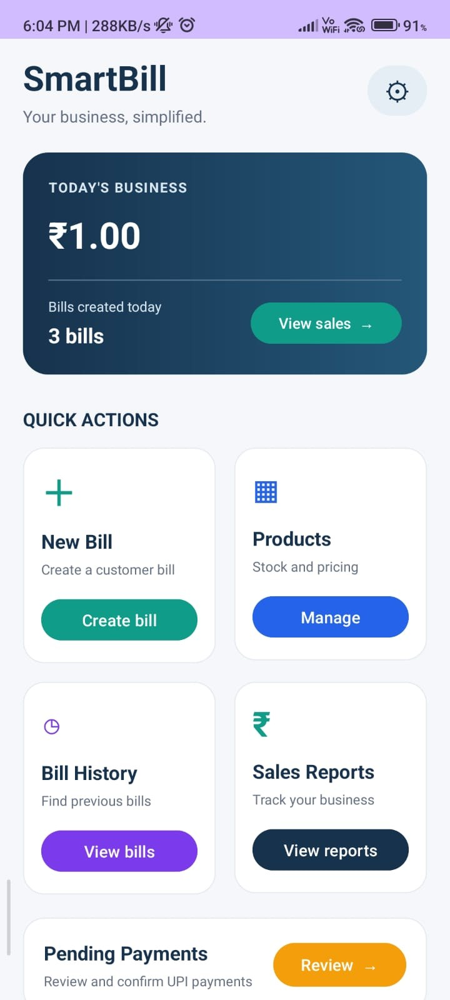
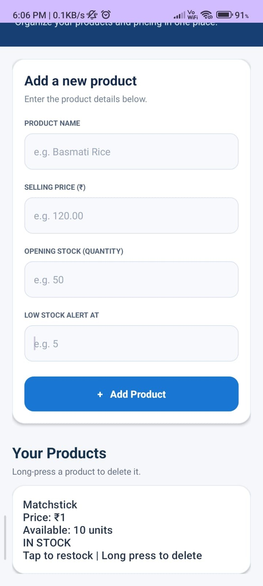
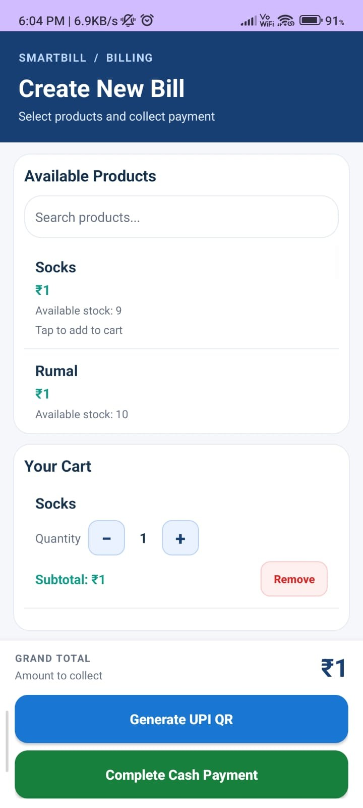
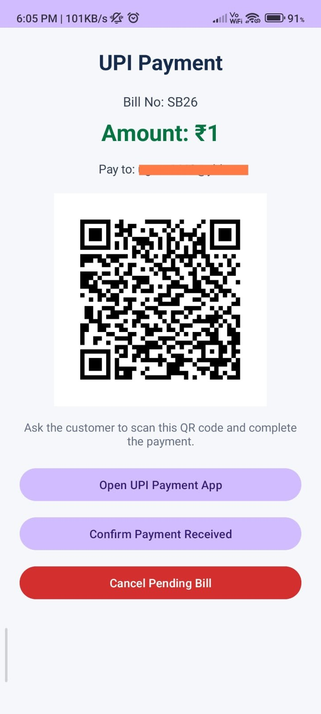
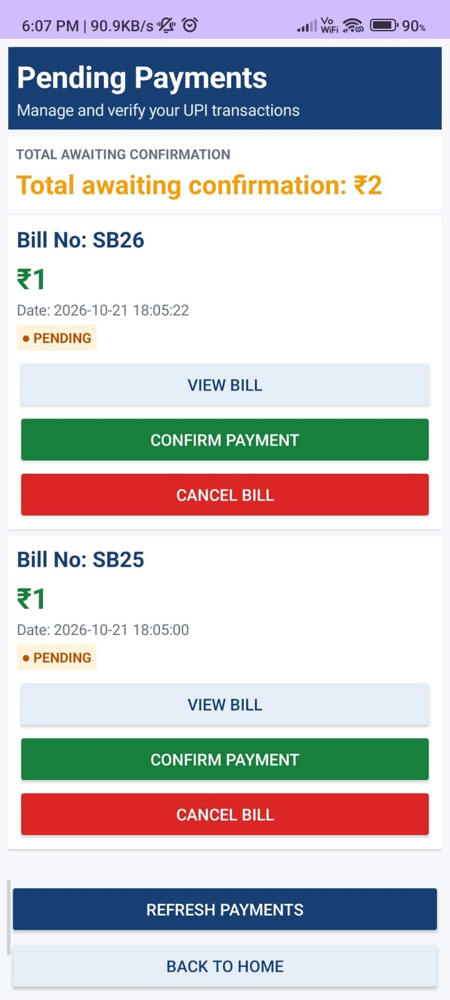
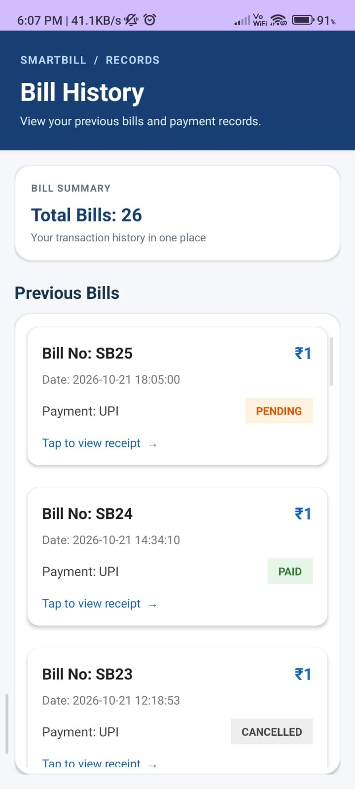
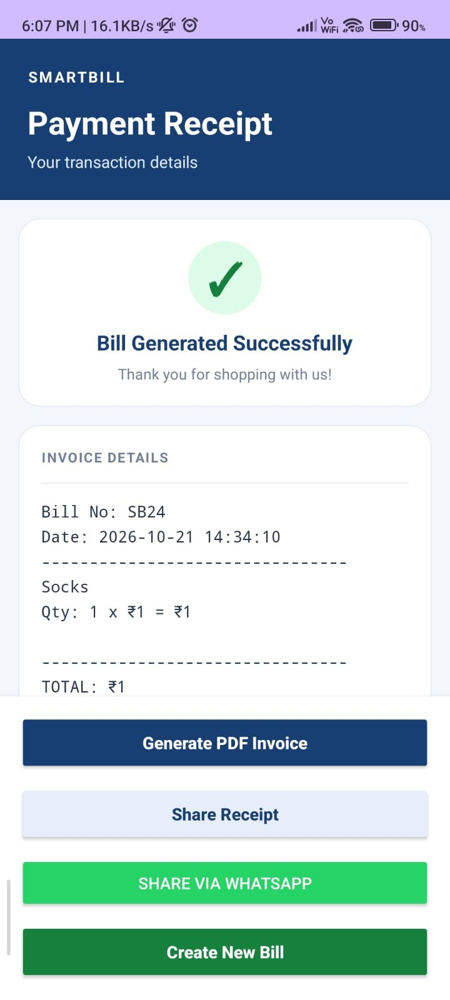
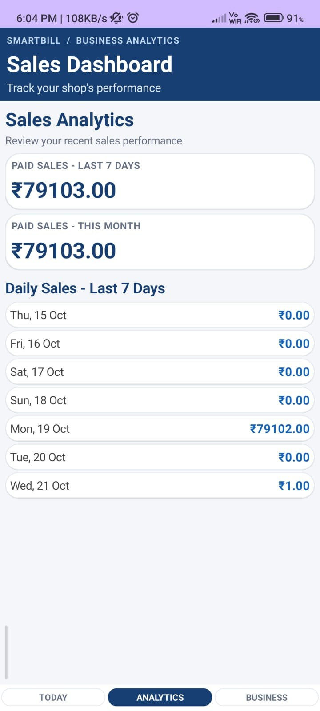

# SmartBill — Android Billing App

A Java-based Android application designed to help small business owners manage products, prepare bills, track payment status, and review sales from a mobile device.

## Features

- Product and stock management
- Billing cart with quantity controls and total calculation
- Cash and UPI QR payment workflows
- Pending-payment review
- Bill history and receipt viewing
- Invoice generation and receipt sharing
- Sales dashboard and analytics
- Local data storage using SQLite

## Technology Stack

- **Language:** Java
- **IDE:** Android Studio
- **UI:** XML / Android UI components
- **Local persistence:** SQLite
- **Version control:** Git and GitHub

## Screenshots

The screenshots below showcase the app's current UI. Open the `screenshots/` folder to view all images.

### Home dashboard


### Product management


### Billing cart


### UPI payment


### Pending payments


### Bill history


### Payment receipt


### Sales analytics


## Getting Started

1. Install Android Studio and the Android SDK.
2. Clone the repository:
   ```bash
   git clone https://github.com/21dharmendra/SmartBill-Android-App.git
   ```
3. Open the project in Android Studio.
4. Allow Gradle to sync and install any required SDK components.
5. Run the app on an emulator or a connected Android device.

## Author

**Dharmendra Goswami** · [GitHub profile](https://github.com/21dharmendra)

---

This project demonstrates Android app development, local database operations, billing workflows, and Git-based project management. Payment status should only be considered confirmed when verified through the app's actual payment-confirmation workflow.
